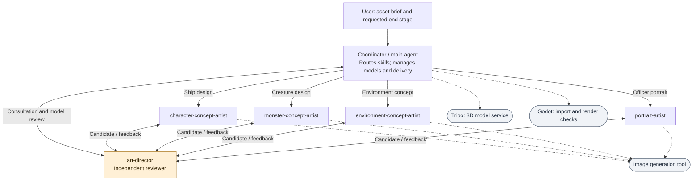

# HAESIN — Art Production Agent System

This is the skill-driven art crew used to develop **HAESIN: Admiral of the Tides**, a naval survival roguelite inspired by the Imjin War. A coordinating agent delegates to specialist artists, while an independent art director reviews their outputs and requests targeted revisions.

The crew produces ship and sea-creature concepts, directional views, static 3D visual assets, and officer portraits for the game. **Skills define the workflow; agents perform the work; image generation, Tripo and Godot are tools.**

## Start here

1. Read the [agent hierarchy](docs/01-agent-hierarchy.md) to meet the crew.
2. Follow the [portrait case study](docs/portrait-case-study.md) to see a real feedback-and-revision cycle.
3. Browse the [ship and creature examples](docs/production-examples.md) and their production records.

## Crew at a glance



[Open the full-size diagram](diagrams/01-agent-hierarchy.svg)

| Role | Responsibility | Input → output |
| --- | --- | --- |
| Coordinator / main agent | Scope, skill routing, model service, evidence and delivery | User brief and accepted handoffs → pipeline records and requested deliverables |
| `character-concept-artist` | Ship-specific design | Subject/style references → ship concepts and directional views |
| `monster-concept-artist` | Creature anatomy and design | Creature references → creature concepts and directional views |
| `environment-concept-artist` | Sea, coast, harbor and environment concepts | Environment brief → concept candidates; shown here as a defined capability |
| `portrait-artist` | Identity-preserving officer portraits | Subject/style references and optional changes → transparent portrait and previews |
| `art-director` | Independent review | Actual candidate, references and records → verdict and actionable corrections |

## Architecture guide

Each diagram answers a different question. Mermaid sources, Markdown views and rendered SVGs are included.

| Diagram | What it explains |
| --- | --- |
| [Agent Hierarchy](docs/01-agent-hierarchy.md) | Who does the work, who reviews it, and which components are tools? |
| [Skills and Dependencies](docs/02-skills-dependencies.md) | How does a request select reusable instructions and unlock later stages? |
| [Ship and Monster Production](docs/03-ship-monster-sequence.md) | What is handed from one agent to the next during a full requested production run? |
| [Portrait Production](docs/04-portrait-sequence.md) | How does a portrait preserve identity while incorporating reviewer feedback? |
| [Shared Context and Artifact Handoffs](docs/05-shared-context.md) | Where are instructions, references, generated files and decisions stored? |
| [Review and Revision Lifecycle](docs/06-review-lifecycle.md) | What happens after approval, feedback, missing evidence, or exhausted attempts? |
| [Actual Production Examples](docs/07-production-evidence.md) | Which observed artifacts substantiate the architecture? |

## Actual output examples

<table>
<tr><th>Scout ship model</th><th>Kraken model</th><th>Officer portrait v002</th></tr>
<tr><td></td><td></td><td></td></tr>
</table>

These existing outputs come from the actual art-production workflow. The model previews are renders of the accompanying GLBs. The portrait was initially recorded as `mounted-officer`, then organized under `kato-kiyomasa` in the delivery catalog.

## Submitted crew and implementation

The representative three-agent run is **coordinator + character-concept-artist + art-director** producing the scout ship. Other specialists cover different asset requests. [Read its actual execution records](docs/recorded-run.md), then [open the implementation and run guide](docs/running-the-crew.md). The original role/skill files and required instruction dependencies are included under `crew/` in their host-facing directory structure.

## How the crew is used

The original workflow runs in an agent host that loads the project’s specialist definitions and skills and provides delegation, image-generation and file tools. The coordinator selects the workflow from the requested result. For example:

```text
$create-ship-asset: produce this ship from its supplied references through a static model.
$create-monster-asset: resume this creature from its accepted concept through the requested stage.
$create-officer-portrait: use the supplied subject and style images; preserve identity and costume.
```

The host must receive the actual required images; model work also needs the configured service access and a user-defined budget. The [definition snapshots](evidence/README.md) show the instructions used to specify the crew. The case pages show recorded execution and output evidence. This documentation update did not start a new art-generation run.

Art approval, technical validation, user selection and actual game integration are recorded separately. The portrait case retains its unmet resolution target, and the player concept retains its original review status. This repository reports those records without upgrading their status.

## Repository map

- `docs/` — seven architecture views, two illustrated case pages, execution evidence and run instructions.
- `crew/` — original role/skill sources, scoped coordinator instructions and selected scout inputs.
- `diagrams/` — matching `.mmd` sources and `.svg` renders.
- `examples/` — existing concepts, three static GLBs, their historical previews and portrait versions.
- `evidence/` — definition snapshots, original review records, portable manifest extracts and file hashes.

The main narrative is English. Original instructions and historical review records are preserved in Korean as source evidence. Start with the illustrated case pages for their English explanation.
