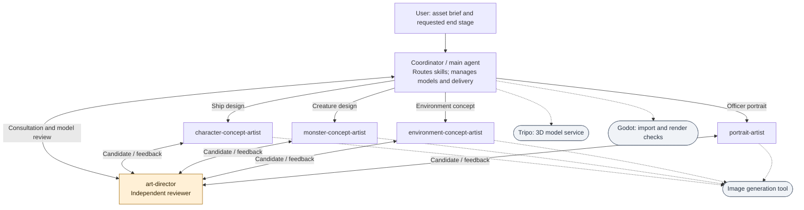

# Agent Hierarchy

**Who does the work, who reviews it, and which components are tools?**

[All diagrams](../README.md#architecture-guide) · [Mermaid source](../diagrams/01-agent-hierarchy.mmd) · [Rendered SVG](../diagrams/01-agent-hierarchy.svg)

The coordinator is the main agent, not a sixth specialist TOML. Five specialist roles are defined. The art director reviews independently and returns findings to the responsible producer. Environment production is a configured capability; the examples in this documentation cover ships, a creature, and portraits. Dashed arrows identify tool use, not additional agents.

## Evidence basis

[agent-workflow.txt](../evidence/definitions/agent-workflow.txt) · [art-director.toml](../evidence/definitions/art-director.toml) · [environment-concept-artist.toml](../evidence/definitions/environment-concept-artist.toml)
