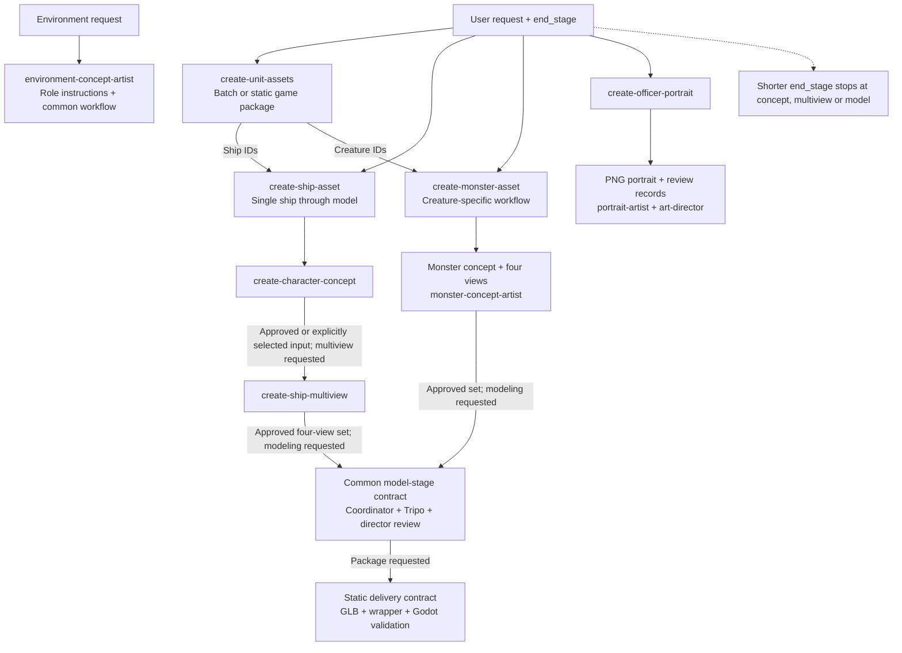

# Skills and Dependencies

**How does a request select reusable instructions and unlock later stages?**

[All diagrams](../README.md#architecture-guide) · [Mermaid source](../diagrams/02-skills-dependencies.mmd) · [Rendered SVG](../diagrams/02-skills-dependencies.svg)

Skills are instruction packages used by agents. They are not additional agents. Ship and creature work share the model/delivery contract while retaining different design specialists. Environment work has a role definition and common workflow; no dedicated environment skill is invented here. Portrait production ends in a 2D master. Each arrow to a later stage is conditional on the requested scope and required evidence.

## Evidence basis

[create-unit-assets.SKILL.txt](../evidence/definitions/create-unit-assets.SKILL.txt) · [create-ship-asset.SKILL.txt](../evidence/definitions/create-ship-asset.SKILL.txt) · [create-monster-asset.SKILL.txt](../evidence/definitions/create-monster-asset.SKILL.txt) · [create-officer-portrait.SKILL.txt](../evidence/definitions/create-officer-portrait.SKILL.txt) · [model-stage.txt](../evidence/definitions/model-stage.txt) · [delivery.txt](../evidence/definitions/delivery.txt)
