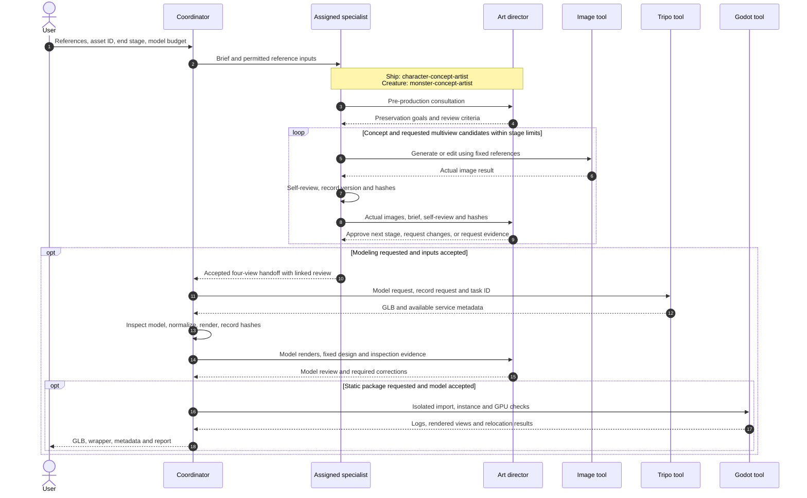

# Ship and Monster Production

**What is handed from one agent to the next during a full requested production run?**

[All diagrams](../README.md#architecture-guide) · [Mermaid source](../diagrams/03-ship-monster-sequence.mmd) · [Rendered SVG](../diagrams/03-ship-monster-sequence.svg)

The image loop abbreviates separate concept and multiview reviews, including the complete four-view set. An unresolved review stops the affected stage; it does not fall through to modeling. Model corrections produce a new version and require fresh review. The coordinator owns model-service work and package validation. A request can stop earlier than the complete sequence shown.

## Evidence basis

[create-ship-asset.SKILL.txt](../evidence/definitions/create-ship-asset.SKILL.txt) · [create-monster-asset.SKILL.txt](../evidence/definitions/create-monster-asset.SKILL.txt) · [model-stage.txt](../evidence/definitions/model-stage.txt) · [delivery.txt](../evidence/definitions/delivery.txt)
