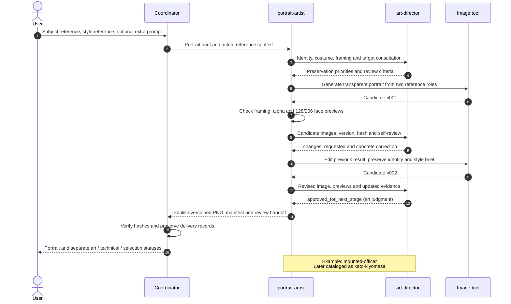

# Portrait Production

**How does a portrait preserve identity while incorporating reviewer feedback?**

[All diagrams](../README.md#architecture-guide) · [Mermaid source](../diagrams/04-portrait-sequence.mmd) · [Rendered SVG](../diagrams/04-portrait-sequence.svg)

This is the specialist-led route documented by the portrait skill. The skill also allows the coordinator to execute directly with independent director review. In the selected example, the recorded producer is portrait-artist. The v002 image call used v001 as its actual edit input; the original subject/style roles remained in the brief. Their original file bytes were not retained. See the case study for the exact historical limitations.

[Read the actual portrait revision case](portrait-case-study.md).

## Evidence basis

[portrait-artist.toml](../evidence/definitions/portrait-artist.toml) · [create-officer-portrait.SKILL.txt](../evidence/definitions/create-officer-portrait.SKILL.txt)
