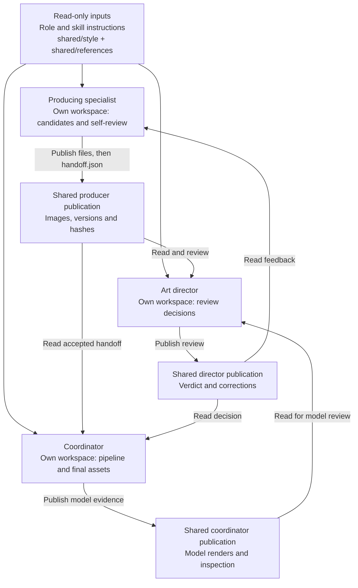

# Shared Context and Artifact Handoffs

**Where are instructions, references, generated files and decisions stored?**

[All diagrams](../README.md#architecture-guide) · [Mermaid source](../diagrams/05-shared-context.mmd) · [Rendered SVG](../diagrams/05-shared-context.svg)

Shared context is implemented through files, versioned handoffs and messages. Each publisher writes only its own publication area; recipients read shared copies instead of another role’s private workspace. handoff.json is published after its files and binds relative paths to SHA-256 values. The access rules are behavioral instructions, not proof of an operating-system sandbox. No vector store or automatic long-term-memory service is implied.

## Evidence basis

[workspace-access.txt](../evidence/definitions/workspace-access.txt) · [agent-workflow.txt](../evidence/definitions/agent-workflow.txt) · [batch-state.txt](../evidence/definitions/batch-state.txt)
