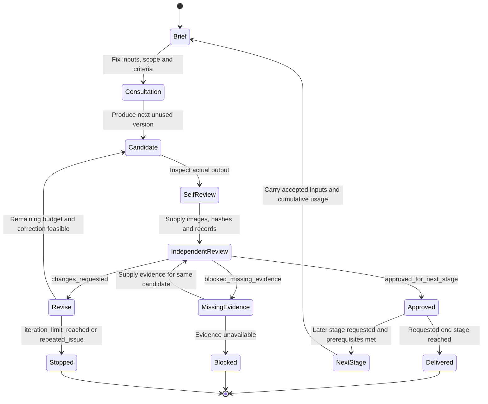

# Review and Revision Lifecycle

**What happens after approval, feedback, missing evidence, or exhausted attempts?**

[All diagrams](../README.md#architecture-guide) · [Mermaid source](../diagrams/06-review-lifecycle.mmd) · [Rendered SVG](../diagrams/06-review-lifecycle.svg)

A correction request is a normal review outcome. It is different from an execution error. The diagram tracks the review of a candidate stage: art approval, technical validation, user selection and runtime integration remain separate fields. A blocked or stopped run retains its latest files and actual verdict. Default concept/portrait limits are three candidates; multiview and model stages have their own documented budgets. A later stage does not reset cumulative usage. Model-service timeouts are reconciled against the saved request/task ID before resubmission.

## Evidence basis

[agent-workflow.txt](../evidence/definitions/agent-workflow.txt) · [create-officer-portrait.SKILL.txt](../evidence/definitions/create-officer-portrait.SKILL.txt) · [model-stage.txt](../evidence/definitions/model-stage.txt) · [batch-state.txt](../evidence/definitions/batch-state.txt)
