# Actual Production Examples

**Which observed artifacts substantiate the architecture?**

[All diagrams](../README.md#architecture-guide) · [Mermaid source](../diagrams/07-production-evidence.mmd) · [Rendered SVG](../diagrams/07-production-evidence.svg)

```mermaid
flowchart LR
    subgraph SH["Ship examples"]
        S1["scout concept v002
Concept approved"] -->|"Recorded production lineage"| S2["scout package v002
Approved GLB + Godot records"]
        P1["player concept v003
changes_requested retained"] -.->|"Associated production records; separate decisions"| P2["player model/package v002
Model approved"]
    end
    subgraph MO["Creature example"]
        K1["kraken concept v002
Concept approved"] -->|"Recorded production lineage"| K2["kraken package v003
Approved GLB + Godot records"]
    end
    subgraph PO["Portrait example"]
        REF["Nobukazu print, 1893
Subject source confirmed by user later"] --> A["mounted-officer v001
Changes requested"]
        A -->|"Same image preserved as edit input"| B["v002
Framing corrected; art approved"]
        B -->|"Later scoped revision"| C["kato-kiyomasa v003
Lower-body framing + preview fix"]
    end
    S2 --> EV["Case pages: actual images, records and SHA-256"]
    P2 --> EV
    K2 --> EV
    C --> EV
```

These are historical production records, not a newly executed art-generation run. Version numbers belong to separate stages and should not be compared as one global counter. Solid lineage arrows abbreviate intermediate stages rather than claiming a direct concept-to-GLB tool call. The player concept remains changes_requested even though the later model has its own approval. Portrait art approval likewise does not make its unfulfilled pixel target complete.

[Ship and creature examples](production-examples.md) · [Portrait case](portrait-case-study.md) · [Source manifest](../evidence/source-manifest.json)

## Evidence basis

[agent-workflow.txt](../evidence/definitions/agent-workflow.txt) · [delivery.txt](../evidence/definitions/delivery.txt)
