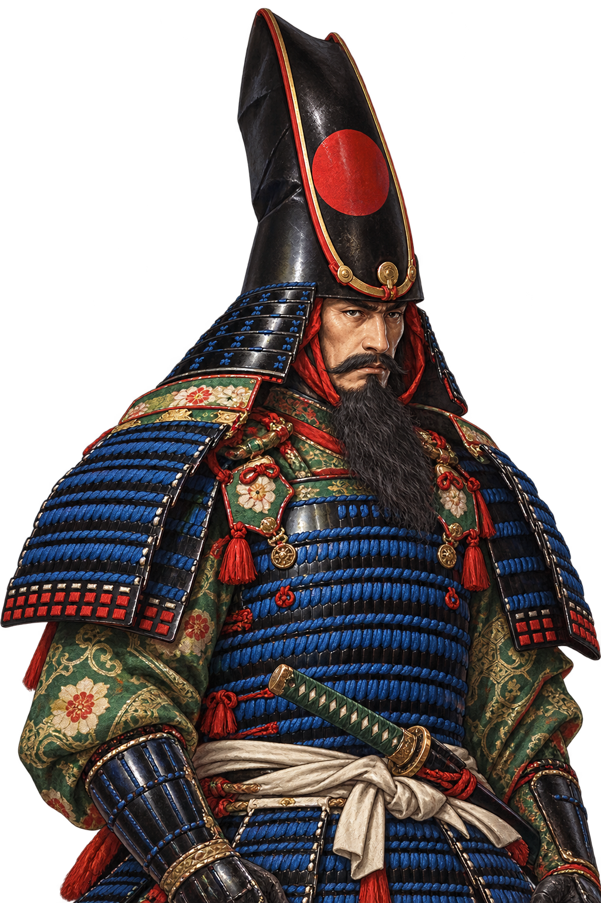
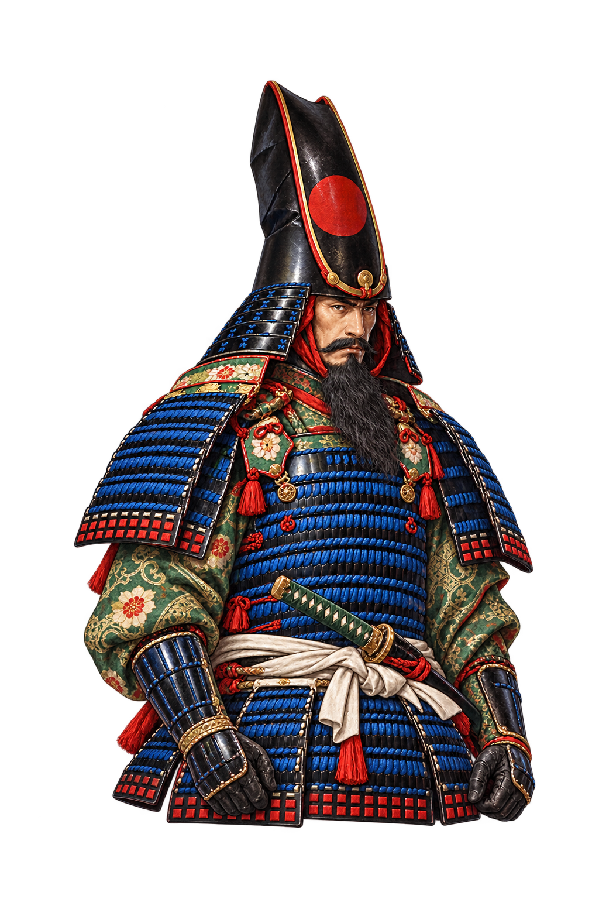
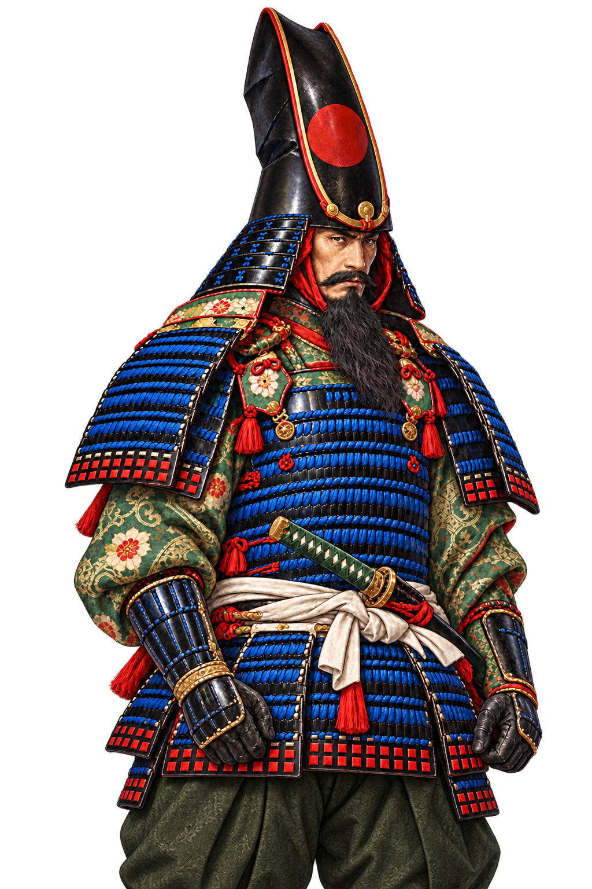

# Portrait Case Study — A Review That Changed the Output

[Back to README](../README.md) · [Portrait sequence](04-portrait-sequence.md) · [Review lifecycle](06-review-lifecycle.md)

The portrait crew creates a reusable officer image for HAESIN’s character UI and special-ability presentation. The subject reference supplies identity and costume; the style reference supplies rendering style. The game-use contract is defined in the [portrait skill](../evidence/definitions/create-officer-portrait.SKILL.txt).

## Recorded identity and roles

This production began with the temporary asset ID **`mounted-officer`**. Its later delivery location and catalog use **`kato-kiyomasa`**. The historical brief did not identify the subject by name, so the later catalog label is not a claim that the agent recognized a historical person from the image.

The [v002 manifest](../evidence/portrait/v002-manifest.json) records **`portrait-artist`** as producer and `/root/new_officer_portrait/mounted_direction` as the independent director agent. It records two generation calls out of an available three.

## Before and after

### Original subject reference

The user confirmed on 2026-10-06 that the original subject reference was **Nobukazu (1874–1944), _Kato Kiyomasa in Korea Viewing Mt. Fuji under a Full Moon_, 1893**, presented by Fuji Arts as an original Japanese woodblock print. [View the source artwork on Fuji Arts](https://www.fujiarts.com/meiji-era-japanese-prints/nobukazu/762045-kato-kiyomasa-in-korea-viewing-mt-fuji-under-a-full-moon-1893).

This attribution was supplied after production, together with a reference image, and supplements the historical `mounted-officer` brief. The original generation-time attachment bytes and hash were not retained, so the newly supplied reference does not establish byte-for-byte identity with that earlier attachment. The original style-reference bytes also remain unavailable. Historical manifests are preserved unchanged.

<table>
<tr><th>v001 — changes requested</th><th>v002 — framing corrected</th></tr>
<tr><td></td><td></td></tr>
</table>

| Step | Recorded action |
| --- | --- |
| Initial brief | Preserve the long mature face, beard, tall helmet and costume while creating one transparent upper-body portrait. |
| v001 review | The manifest records `changes_requested`. The later review identifies shoulder and hand clipping as the issue resolved in v002. |
| Edit request | Keep identity, expression and costume; reduce the figure within the canvas, add framing space, and retain complete hands. |
| Actual image input | The edit used the saved v001 image. Original subject and style references remained in the brief; their file bytes were not retained. |
| Independent v002 review | The director checked the actual image, background composites, 128/256 face previews and target PNG hash. Shoulder/hand clipping was resolved; art verdict: `approved_for_next_stage`. |

The original v001 version folder is absent from the coordinator delivery copy. The before image above is the **byte-identical saved edit input** in the v002 handoff; its SHA-256 matches the v001 manifest entry. This preserves the real comparison without reconstructing an earlier image.

## Result and limits

| Dimension | Recorded result |
| --- | --- |
| Art review | `approved_for_next_stage` |
| Actual output | PNG RGBA, **1024 × 1536** |
| Requested size | 2048 × 3072; `technical_target_met: false` |
| Alpha | Recorded range 0–254; low-alpha noise remains a technical note |
| Input retention | Subject/style attachment bytes not saved; v001 edit-input bytes saved |
| User selection | `pending` |
| Game integration | `not_requested` in this production record |

The approved art correction is concrete even though the technical pixel target remains unmet. The original [review](../evidence/portrait/v002-review.md), [prompt](../evidence/portrait/v002-prompts.md), [input record](../evidence/portrait/v002-inputs-manifest.json) and [handoff](../evidence/portrait/v002-handoff.json) document these separate results.

## Later follow-up: v003

A later request extended the lower costume into a natural upper-thigh crop. Its [review record](../evidence/portrait/v003-review.md) also documents a correction to distorted face previews: the master image and its hash were kept, while square crops were regenerated for the preview comparison. The director confirmed the corrected previews and retained art approval. The [output metadata](../evidence/portrait/v003-output.json) still records 1024 × 1536 and an unmet target. This later work is a separately scoped revision, not an unrecorded extra attempt in the initial two-call run.

## Verify the image lineage

| Image | SHA-256 |
| --- | --- |
| v001 / saved edit input | `47e3a32fdd03f59c8006ea6c60e7e26fe65ea249b63c67e27ce123506d1a65c8` |
| v002 | `ba5f7168d171ee72484e1785556ce62e79153aadfb37f13a4281681bfd8b8df1` |
| v003 | `1f74682ef22aec5eadb6af139b350dd14b10542e881de083fa74219ba03bf886` |
