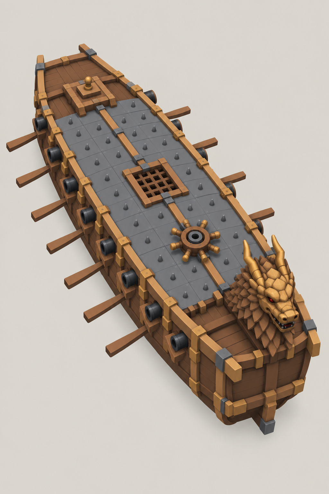
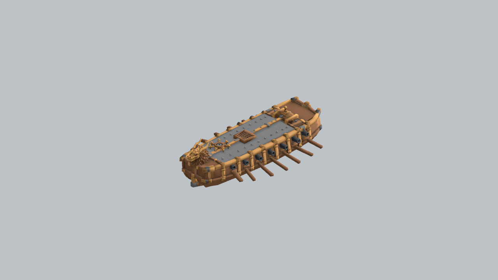
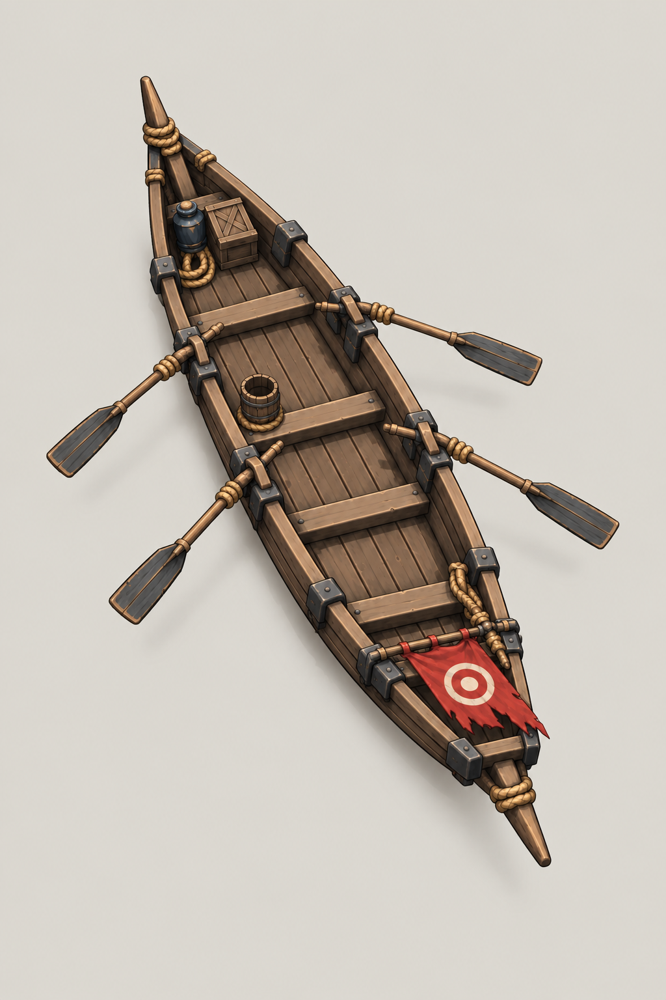
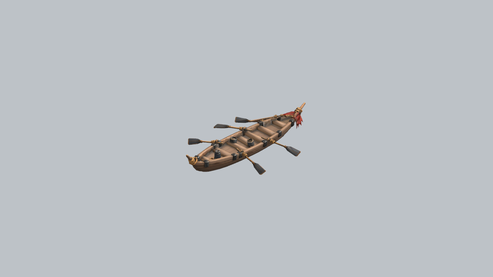
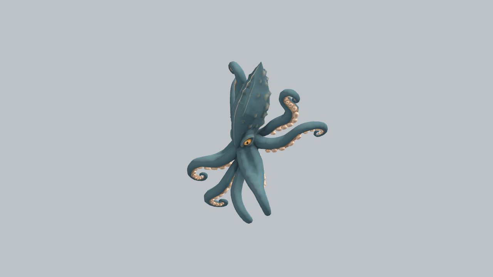

# Ship and Creature Production Examples

[Back to README](../README.md) · [Production sequence](03-ship-monster-sequence.md) · [Evidence map](07-production-evidence.md)

These are existing outputs and historical production records. Each concept and GLB is linked by asset ID, stage version and SHA-256. The model files are included for inspection; the previews are historical renders.

## Turtle ship — `player`

A turtle-ship fleet visual. The asset ID `player` is a production identifier and does not establish the starting ship in the latest game design.

<table><tr><th>Concept v003</th><th>Model package v002</th></tr><tr><td></td><td></td></tr></table>

- Concept verdict: `changes_requested`.
- Model verdict: `approved_for_next_stage`.
- Historical package records report original and relocated Godot import, instantiation and GPU checks as passed.
- [Static GLB](../examples/player/player.glb) · [Package report](../evidence/player/package-report.md) · [Portable record](../evidence/player/package-summary.json) · [Concept review handoff](../evidence/player/concept-review-handoff.json)

The unresolved concept review is retained. The model has a separate later approval; this case must not be read as automatic approval of every upstream stage.

## Scout ship — `scout`

A small enemy reconnaissance ship for HAESIN naval encounters.

<table><tr><th>Concept v002</th><th>Model package v002</th></tr><tr><td></td><td></td></tr></table>

- Concept verdict: `approved_for_next_stage`.
- Model verdict: `approved_for_next_stage`.
- Historical package records report original and relocated Godot import, instantiation and GPU checks as passed.
- [Static GLB](../examples/scout/scout.glb) · [Package report](../evidence/scout/package-report.md) · [Portable record](../evidence/scout/package-summary.json) · [Concept review handoff](../evidence/scout/concept-review-handoff.json)

## Kraken — `kraken`

An allied fantasy sea-creature visual. Creature anatomy belongs to the monster specialist, separately from ship design.

<table><tr><th>Concept v002</th><th>Model package v003</th></tr><tr><td></td><td></td></tr></table>

- Concept verdict: `approved_for_next_stage`.
- Model verdict: `approved_for_next_stage`.
- Historical package records report original and relocated Godot import, instantiation and GPU checks as passed.
- [Static GLB](../examples/kraken/kraken.glb) · [Package report](../evidence/kraken/package-report.md) · [Portable record](../evidence/kraken/package-summary.json) · [Concept review handoff](../evidence/kraken/concept-review-handoff.json)

## Evidence boundary

These packages provide static visual assets. Their historical records do not establish rigging, animation, gameplay collision, current runtime integration or target-device performance. The source packages record license status as `unknown`; this document does not change that status.
